# FitZone Sports — Manual de usuario

## 1. Qué es FitZone Sports y para qué sirve

**FitZone Sports** es una plataforma web para una cadena de gimnasios con varias sucursales (sedes). Unifica en un solo sistema:

* **Control de acceso:** el socio entra a cualquier sede con un código QR que cambia cada minuto, y la sede conoce en tiempo real cuánta gente hay adentro (aforo).

* **Clases grupales:** reserva de lugar, lista de espera y avisos cuando se libera un cupo.

* **Alquiler de canchas:** consulta de horarios, precio según el perfil del cliente y pago en línea.

* **Membresías y pagos:** contratación y renovación de planes, con comprobante en PDF.

El sistema se usa desde el navegador, en computadora o celular, y tiene cuatro perfiles de usuario:

| Perfil | Quién es | Qué puede hacer | 
| ----- | ----- | ----- | 
| **Socio** | Persona con membresía | Ver su actividad, usar su QR, reservar clases y canchas, renovar su membresía y bajar sus comprobantes. | 
| **Cliente externo** | Persona sin membresía que alquila canchas | Reservar canchas. Solo ve la pantalla **Canchas**. | 
| **Personal de sede** *(Recepcionista / Administrador)* | Empleado de una sede | Validar ingresos, dar de alta usuarios, gestionar la agenda de clases, administrar socios y membresías. | 
| **Gerente central** | Responsable de la cadena | Todo lo anterior y, además, administrar los planes de membresía. | 

## 2. Cómo leer este manual · Glosario

El manual está dividido por perfil. Si sos socio, leé la **sección 3**; si trabajás en una sede, la **sección 4**; si sos gerente, la **sección 5**. La **sección 6** reúne las preguntas frecuentes y la **sección 7** lista las limitaciones conocidas de esta versión.

### Glosario

| Término | Significado | 
| ----- | ----- | 
| **Sede** | Sucursal de la cadena. Se elige en el selector de la barra superior y condiciona lo que ves (clases, canchas, aforo). | 
| **Aforo** | Cantidad de socios que están dentro de una sede en este momento, frente al cupo máximo de esa sede. | 
| **QR rotativo** | Código QR del socio que se renueva cada 60 segundos para que una captura de pantalla no sirva. | 
| **Molinete inteligente** | Al escanear el QR, el sistema registra solo si corresponde una entrada o una salida. | 
| **Lista de espera** | Cola de socios que quieren una clase ya completa. Si alguien cancela, se ofrece el lugar al primero de la cola. | 
| **Oferta temporal** | Lugar ofrecido a un socio de la lista de espera. Dura 15 minutos y hay que aceptarlo antes de que venza. | 
| **Horario pico** | Franja horaria con tarifa de cancha más alta. | 
| **Token de pago** | Código que reemplaza a los datos de la tarjeta. El sistema nunca pide número de tarjeta ni CVV. | 
| **Modo offline** | Funcionamiento de la terminal de recepción cuando se cae la conexión con el servidor central. | 
| **En mora** | Socio cuya fecha de vencimiento de la cuota ya pasó. | 

### Elementos comunes de la pantalla

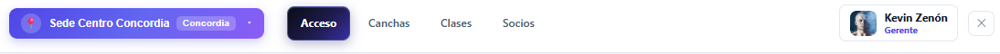
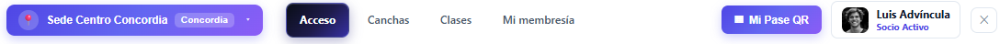
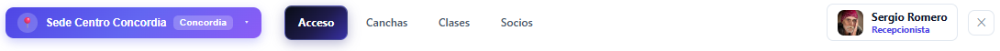
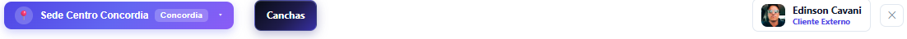
* **Selector de sede (arriba a la izquierda):** cambia la sede con la que trabajás. Se recuerda entre sesiones.

* **Pestañas de navegación:** cambian según tu perfil:

  * **Socio:** Acceso, Canchas, Clases, Mi membresía.

  * **Personal y gerente:** Acceso, Canchas, Clases, Socios.

  * **Cliente externo:** solo Canchas.

* **Mi Pase QR:** botón violeta que ven únicamente los socios.

* **Tarjeta de perfil y `✕`:** muestran tu nombre y perfil; la `✕` cierra la sesión.

* **Sesión:** dura 30 minutos. Pasado ese tiempo, el sistema te lleva a la pantalla de ingreso y tenés que volver a loguearte.

## 3. Manual del Socio

### 3.1 Registro y carga del perfil

El socio no se registra por su cuenta. En la pantalla de ingreso no hay opción de *"registrarse"*: el alta la hace el personal de la sede.

1. Acercate a recepción con tu DNI.

2. El personal te da de alta desde **Socios → + Nuevo socio**, cargando nombre, DNI, contacto (mail o teléfono) y una contraseña inicial.

3. Con tu DNI (o tu contacto) y esa contraseña, ingresás desde la pantalla de acceso.

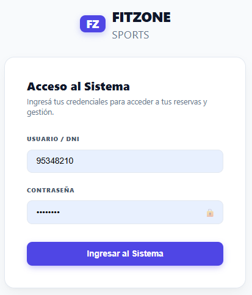

**Para ingresar:** escribí tu DNI o tu mail/teléfono de contacto, tu contraseña y tocá **Ingresar al Sistema**. Si los datos son incorrectos aparece el mensaje *"Usuario o contraseña incorrectos"*. Un usuario suspendido tampoco puede ingresar.

Tus datos personales (nombre, DNI, contacto, fecha de alta) están en **Mi membresía**. Si algo está mal, pedile al personal que lo corrija: el socio no edita su propio perfil.

### 3.2 Contratación y renovación de la membresía

Entrá a **Mi membresía**. Ahí ves:

* El estado: **Activo**, **Vencido** o **Suspendido**.

* La fecha de vencimiento y los días que faltan, con la leyenda *Al día* o *Cuota vencida*.

* El historial de pagos.

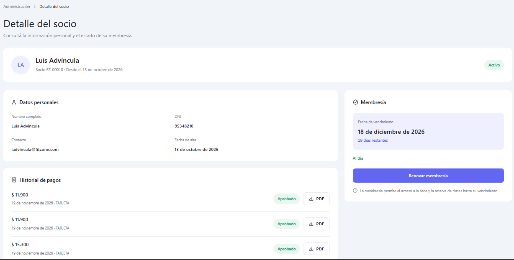

**Para renovar o contratar:**

1. Tocá **Renovar membresía**.

2. Elegí el plan (se muestra con su precio).

3. Elegí el método de pago: **Mercado Pago** o **MODO**.

4. El campo **Token de pago simulado** viene completado. No cambia nada del cobro real: reemplaza a los datos de la tarjeta. Nunca ingreses tu número de tarjeta ni el CVV.

5. Tocá **Pagar y renovar**.

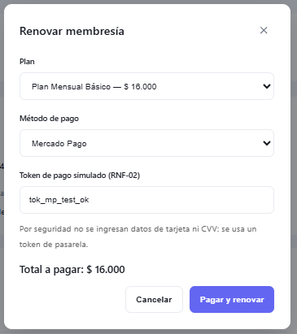

**Qué puede pasar:**

| Resultado | Qué ves | Qué ocurre con la membresía | 
| ----- | ----- | ----- | 
| **Pago aprobado** | Cartel verde *"Pago aprobado..."* con el número de pago y un botón para bajar el comprobante. | Se extiende el vencimiento. | 
| **Pago rechazado** | Alerta roja dentro del modal con el motivo. | No se renueva. | 
| **Pago pendiente de acreditación** | Alerta en el modal. | No se renueva hasta que se acredite. | 
| **Error de seguridad o de datos** | Alerta roja con el mensaje del sistema. | No se renueva. | 

* **Cómo se calcula el nuevo vencimiento:** si tu membresía todavía está vigente, la duración del plan se suma al vencimiento actual (no perdés días). Si ya venció, se cuenta desde hoy. Los planes pueden ser mensuales (30 días), trimestrales (90) o anuales (365).

* Si hacés clic dos veces seguidas, el sistema evita el cobro duplicado: cada intento lleva una clave única.

### 3.3 Obtención del código QR desde el portal e ingreso al gimnasio

1. Tocá **Mi Pase QR** (botón violeta de la barra superior).

2. Se muestra tu QR y un contador *"Se renueva en: N s"*. Cada 60 segundos se genera uno nuevo automáticamente.

3. Apoyalo en el lector de la sede.

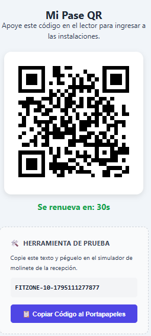

El sistema funciona como un **molinete inteligente**: si estás afuera, el escaneo registra tu entrada; si ya estás adentro, registra tu salida y libera tu lugar en el aforo. No hay que elegir nada.

**Para poder entrar necesitás:**

* Una membresía **activa y vigente** (no vencida ni suspendida).

* **No estar ya dentro de otra sede.** Un socio solo puede estar en una sede a la vez. Para entrar a otra sucursal, primero escaneá tu salida en la anterior.

* Que la sede no haya alcanzado su cupo máximo.

> **Nota:** Podés entrar a cualquier sede de la cadena sin hacer ningún trámite adicional. En el cuadro de **Mi Actividad** (pestaña *Acceso*) ves tus últimos 5 accesos, tus reservas de canchas y tus clases grupales.

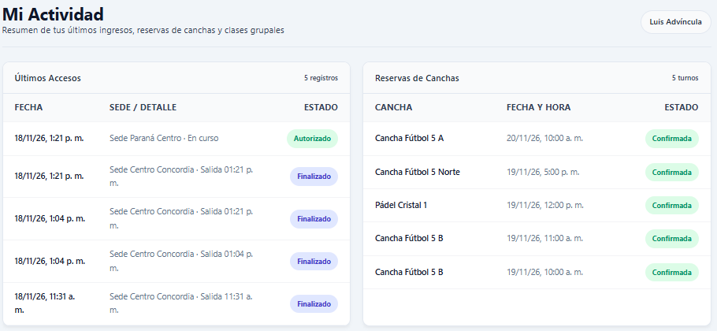

El QR se genera en tu propio dispositivo: abrí la página con conexión al menos una vez antes de ir a la sede.

### 3.4 Qué hacer si el QR no es aceptado o la sede está sin conexión

Recepción ve el motivo exacto del rechazo. Los más comunes son:

| Mensaje | Causa | Qué hacer | 
| ----- | ----- | ----- | 
| *Código QR expirado. Por favor, utilice el código actual en su pantalla.* | El QR tiene más de \~65 segundos. | Esperá a que se renueve (el contador llega a 0) y volvé a mostrarlo. No uses capturas de pantalla. | 
| *Formato de código QR no reconocido por FitZone.* | No es un QR del sistema. | Abrí **Mi Pase QR** desde tu cuenta. | 
| *El socio no posee una membresía activa.* | Cuota vencida, plan inexistente o usuario suspendido. | Renová en **Mi membresía** o consultá en recepción. | 
| *El socio ya registra un ingreso activo en una sucursal.* | Figurás adentro de otra sede. | Escaneá tu salida en esa sede. | 
| *La sucursal ha alcanzado su capacidad máxima de aforo.* | Sede llena. | Esperá a que salga alguien. | 
| *Socio no encontrado o QR inválido.* | Código con un usuario inexistente. | Consultá en recepción. | 

* **Si la sede está sin conexión:** la terminal de recepción sigue validando QR con una copia local de los socios que descargó la última vez que tuvo conexión. Vos no tenés que hacer nada distinto: mostrás tu QR como siempre. Recepción verá el aviso *"(Modo Offline)"* en la confirmación. Los ingresos quedan registrados y se envían al servidor cuando la conexión vuelve.

* **Limitación:** en modo offline solo se reconocen los socios que estaban en la copia local. Una membresía renovada o un alta hecha minutos antes de la caída puede no figurar todavía.

### 3.5 Reserva de clases grupales y lista de espera

Entrá a **Clases**. Se listan las clases de la sede seleccionada en la barra superior.

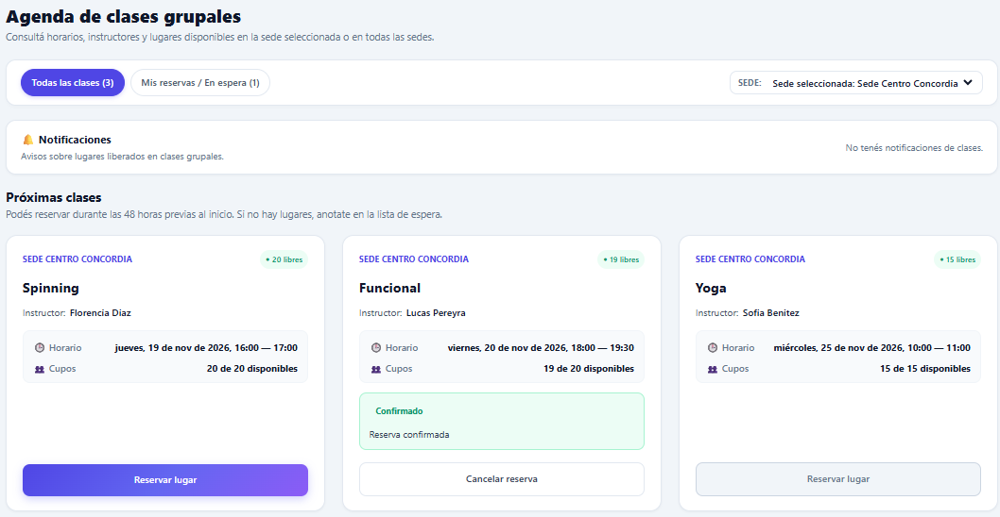

**Solapas:**

* **Todas las clases:** toda la agenda.

* **Mis reservas / En espera:** solo las clases donde estás inscripto.

Cada tarjeta muestra la clase, el instructor, el horario, los lugares disponibles y tu estado.

**Reservar un lugar:**

* Tocá **Reservar lugar**. Solo se habilita durante las 48 horas previas al inicio de la clase y si hay cupo.

* Necesitás membresía activa y vigente.

* No podés tener dos inscripciones activas en la misma clase.

**Si la clase está completa:**

* Aparece **Sumarme a la lista de espera**. Podés anotarte hasta que la clase comience.

* Cuando alguien cancela, el sistema ofrece el lugar al primero de la lista (por orden de llegada). Si ese socio ya no tiene membresía vigente, se lo saltea.

**Cuando te ofrecen un lugar:**

1. Aparece una notificación en la sección **Notificaciones** de la pantalla *Clases*, y tu estado pasa a **Oferta disponible**.

2. Tenés **15 minutos** para tocar **Aceptar lugar ofrecido**.

3. Si no aceptás a tiempo, la oferta vence (**Oferta vencida**) y pasa al siguiente.

4. Podés rechazarla con **Rechazar lugar ofrecido**.

5. Tocá **Marcar como leída** en cada notificación para ordenarlas.

**Estados que vas a ver:**

| Estado | Significado | 
| ----- | ----- | 
| **Reserva confirmada** | Tenés lugar asegurado. | 
| **En lista de espera** | Estás en la cola esperando liberación de cupo. | 
| **Oferta disponible** | Tenés 15 minutos para aceptar el lugar ofrecido. | 
| **Cupo confirmado desde la lista de espera** | Aceptaste la oferta a tiempo. | 
| **Cancelado / Oferta vencida / No elegible** | Ya no tenés lugar (*no elegible*: se perdió la membresía vigente). | 

*(La agenda se actualiza sola cada 30 segundos).*

### 3.6 Reserva de canchas y cómo se calcula el precio

Entrá a **Canchas** (también es la única pantalla del cliente externo).

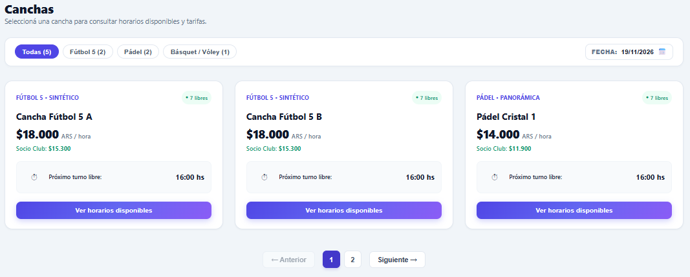

1. Elegí la sede (barra superior) y la fecha (selector **FECHA**).

2. Filtrá por deporte con las píldoras (*Todas, Pádel, Fútbol 5...*).

3. Cada tarjeta muestra el tipo de cancha, cuántos turnos libres quedan, el precio por hora, el precio de **Socio Club** y el próximo turno libre.

4. Tocá **Ver horarios disponibles**: se abre un panel lateral con todos los turnos del día.

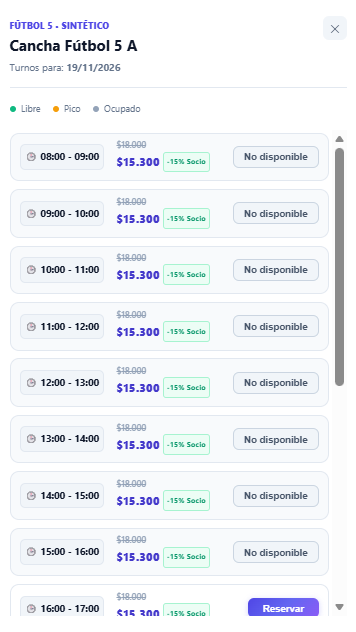

Cada turno muestra el horario, un sello **PICO** si está en horario pico, el precio de lista tachado y el precio con descuento de socio (-15%). Los turnos ocupados o que ya empezaron hoy figuran como *Ocupado* o *No disponible*.

**Cómo se calcula el precio:**

* La cancha tiene un precio base por hora.

* En horario pico (que se configura por cancha y día) se aplica el precio pico.

* Los socios obtienen **15% de descuento** sobre la tarifa que corresponda.

* El socio en mora pierde el descuento y paga como externo (regla RN-03; ver sección 7).

**Para reservar:**

1. Tocá **Reservar** en el turno elegido.

2. En el cuadro **Confirmar Reserva** revisá cancha, fecha, horario y total.

3. Elegí la forma de pago **Tarjeta / Online** y tocá **Pagar y Confirmar**.

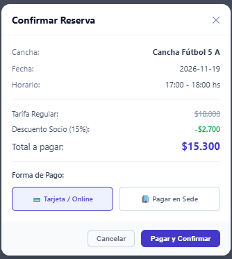

**Resultados posibles:**

* **Éxito:** mensaje verde *"¡Turno reservado y pago registrado correctamente!"* y el turno pasa a *Ocupado*.

* **Pago rechazado:** la reserva no se concreta y el horario queda libre.

* **Horario ya reservado:** si otra persona confirmó el mismo turno un instante antes, recibís el aviso *"El horario seleccionado ya se encuentra ocupado o reservado"*. Elegí otro turno. Nunca se confirman dos reservas sobre el mismo horario.

Tus reservas aparecen en **Mi Actividad** (pestaña *Acceso*) como *Confirmada*, *Pendiente* o *Cancelada*.

### 3.7 Cancelaciones, plazos y penalidades

El sistema no aplica penalidades económicas. Sí aplica plazos:

| Acción / Estado | Regla | 
| ----- | ----- | 
| **Clase con lugar confirmado** | Se puede cancelar hasta **2 horas antes** del inicio. Después de ese límite el botón se deshabilita. | 
| **Lista de espera u oferta pendiente** | Se puede abandonar en cualquier momento antes de que la clase empiece. | 
| **Reserva de clase** | Solo se abre en las **48 horas previas** al inicio. | 
| **Reserva de cancha** | En esta versión no hay botón para cancelarla desde el portal (ver sección 7). | 

Para cancelar una clase: en **Clases**, tocá **Cancelar reserva** (o *Salir de la lista de espera*) y confirmá. Al cancelar un lugar confirmado, el sistema ofrece automáticamente ese cupo a la lista de espera.

### 3.8 Comprobantes de pago

1. Entrá a **Mi membresía**.

2. En **Historial de pagos** cada pago *Aprobado* tiene un botón **PDF**.

3. Al tocarlo se descarga el comprobante.

También aparece un botón **Descargar comprobante PDF** en el cartel verde que se muestra inmediatamente después de renovar.

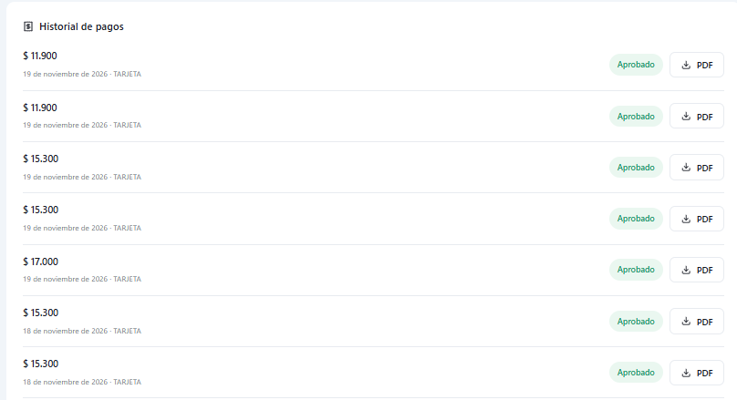

El comprobante incluye: número (`FZ-000123`), fecha, ID de socio, concepto, medio de pago, identificador de la transacción, estado y total abonado. El historial incluye tanto las renovaciones como los pagos de canchas.

## 4. Manual del Recepcionista / Administrador de sede

### 4.1 Validación de ingreso y lectura del aforo

Al ingresar, la pantalla inicial es el **Panel de Recepción**. Antes de empezar, verificá en el selector de la barra superior que estés parado en tu sede.

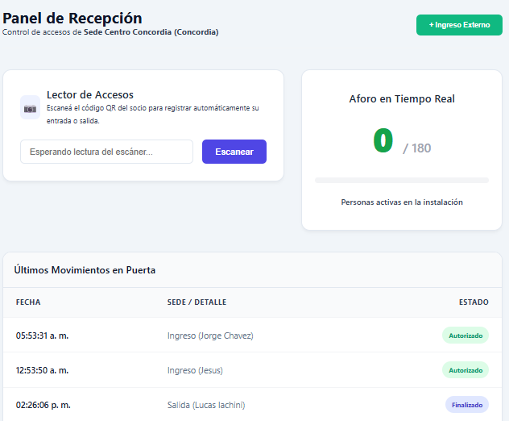

El panel tiene tres bloques:

1. **Lector de Accesos:** campo de texto que recibe el código del QR. El lector físico funciona como un teclado y *"escribe"* el código; el campo ya está enfocado al abrir la pantalla.

2. **Aforo en Tiempo Real:** personas adentro frente al cupo de la sede. El número cambia de color: **verde** (menos de 70%), **naranja** (70% o más) y **rojo** (100%, capacidad máxima).

3. **Últimos Movimientos en Puerta:** los 5 movimientos más recientes de la sede.

**Procedimiento de ingreso:**

1. Escaneá el QR del socio (o pegá el código y tocá **Escanear**).

2. Mirá el aviso que aparece abajo a la derecha:

   * **Verde:** *Ingreso exitoso* o *Salida registrada correctamente*.

   * **Rojo:** acceso denegado, con el motivo exacto (ver sección 4.4).

3. El aforo y la tabla se actualizan solos. No hay que elegir entre *"entrada"* y *"salida"*.

**Ingreso de cliente externo (para quien alquila una cancha y no es socio):**

1. Tocá **+ Ingreso Externo** (arriba a la derecha).

2. Completá **Nombre completo** y **DNI** (7 a 9 números, sin puntos).

3. Tocá **Registrar Ingreso**.

4. Aparece el aviso verde *"Nuevo cliente externo \[nombre\] dado de alta e ingresado con éxito"*.

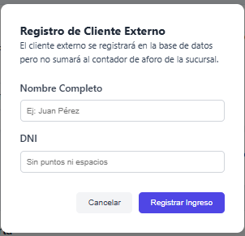

**Reglas:**

* Si el cliente externo ya existía, se reutiliza su cuenta y el aviso lo indica.

* Si el DNI pertenece a un socio, el sistema lo rechaza: el socio debe escanear su QR.

* Si el DNI pertenece a personal del sistema, también se rechaza.

* Los clientes externos no suman al aforo del gimnasio.

* La cuenta nueva queda con el DNI como contraseña inicial y el contacto `externo.<dni>@fitzone.com`. Si el cliente quiere reservar canchas desde su celular, puede ingresar con su DNI y esa contraseña.

**Alta de socios y clientes externos:**

En **Socios → + Nuevo socio** elegí el **Perfil** (*Socio* o *Cliente externo*) y completá nombre, DNI (7 u 8 números), contacto y una contraseña de al menos 6 caracteres. Al guardar aparece el aviso *"Socio creado correctamente"*.

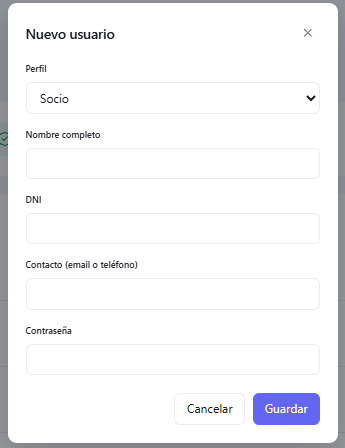

**Administración de socios:**

* En **Socios** ves la lista con buscador (por nombre o DNI), filtros por perfil y por estado de membresía (*Activo / Vencido*) y tres indicadores: socios registrados, membresías activas y vencidas.

* Tocá un socio para abrir su ficha. Desde ahí podés:

  * **Editar socio:** cambiar nombre, contacto y estado (*Activo / Suspendido*). Un socio suspendido no puede ingresar al sistema ni a la sede.

  * **Renovar membresía** en su nombre.

  * Ver el **historial de pagos** y bajar cada comprobante en PDF.

* La ficha de clientes externos muestra *Sin membresía* hasta que contraten un plan.

### 4.2 Gestión de la agenda de clases

Entrá a **Clases**. Si sos recepcionista de sede, tenés que seleccionar tu sede asignada en el selector; si no, el sistema te lo pide. Solo podés gestionar clases de tu sede.

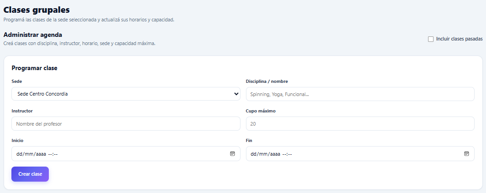

* **Programar una clase:** completá Sede, Disciplina/nombre, Instructor, Cupo máximo, Inicio y Fin y tocá **Crear clase**.

  * La fecha de inicio debe estar en el futuro y el fin debe ser posterior al inicio.

  * El cupo debe ser un entero mayor a 0.

* **Editar:** tocá **Editar** en la tarjeta, el formulario se completa con los datos; modificalos y tocá **Guardar cambios**. Restricciones:

  * No se puede reducir el cupo por debajo de la cantidad de reservas confirmadas.

  * No se pueden cambiar las fechas de una clase con inscripciones activas.

  * Si aumentás el cupo, los lugares nuevos se ofrecen a la lista de espera.

* **Ver inscriptos:** botón que despliega la lista de participantes con su estado.

* **Eliminar:** el sistema pide confirmación. No se puede eliminar una clase con reservas activas (*"No se puede eliminar la clase porque cuenta con N reserva(s) activa(s). Cancelá las inscripciones primero"*) ni una que tenga historial de inscripciones.

* El gerente puede marcar **Incluir clases pasadas** para ver el historial.

### 4.3 Inhabilitación de una cancha por mantenimiento

> **Fuera del alcance de esta versión.** El sistema no incluye una pantalla para inhabilitar canchas. Una cancha deja de ofrecerse solo si su estado se cambia directamente en la base de datos (`cancha.estado` distinto de `disponible`); consultá al responsable técnico.

### 4.4 Problemas frecuentes del mostrador y cómo resolverlos

| Problema | Causa probable | Solución | 
| ----- | ----- | ----- | 
| El socio dice que su QR no funciona y el aviso es *"QR expirado"* | Mostró una captura o el contador estaba en cero. | Pedirle que espere el próximo código y lo muestre en vivo. | 
| *"No posee una membresía activa"* | Cuota vencida o usuario suspendido. | Revisar su ficha en **Socios**; renovar si corresponde o reactivarlo con **Editar socio**. | 
| *"Ya registra un ingreso activo en una sucursal"* | El socio no escaneó su salida en otra sede. | Escanear la salida en esa sede, o consultar a la otra sede. | 
| *"El socio tiene un ingreso activo en otra sucursal distinta a esta"* al escanear la salida | Se está escaneando la salida en una sede distinta de la entrada. | Hacerlo en la sede de ingreso. | 
| El aforo no coincide con lo esperado | Se cambió el selector de sede. | Verificar la sede en la barra superior. | 
| *"Tu perfil no tiene una sede asignada para gestionar clases"* | Falta la asignación de sede del recepcionista. | Pedir al responsable técnico que lo asigne. | 
| *"Seleccioná \[sede\] en el selector de sedes para gestionar su agenda"* | Selector en otra sede. | Elegir la sede asignada. | 
| Nada responde y aparece la pantalla de ingreso | Pasaron 30 minutos de sesión. | Volver a ingresar. | 
| El aviso dice *"(Modo Offline)"* | Se cayó la conexión con el servidor. | Seguir operando; se sincroniza sola al reconectar (ver abajo). | 
| *"Socio no encontrado en el padrón local de contingencia"* | Estás offline y el socio no estaba en la copia local. | Esperar a la reconexión o registrar el ingreso a mano luego. | 

**Operación sin conexión (modo offline):**

* Mientras se cae la conexión, el panel sigue funcionando con la copia local (socios, sedes y aforo). Cada ingreso o salida queda en una cola del navegador.

* Al volver la conexión, la cola se envía automáticamente (en orden cronológico) en el siguiente escaneo o al recargar el panel. Los eventos repetidos no se duplican.

* No cierres el navegador ni borres los datos del sitio mientras haya eventos pendientes de sincronizar.

* Para que funcione, el panel debe haberse abierto al menos una vez con conexión ese día.

## 5. Manual del Gerente central

El gerente tiene acceso a todas las funciones del personal de sede (sección 4) y a las clases de todas las sedes.

### 5.1 Alta y configuración de una sede

> **Fuera del alcance de esta versión.** El sistema no incluye una pantalla de alta de sedes. Las sedes se cargan en la base de datos; el procedimiento está en el *Manual de instalación y operación, sección 9*.

### 5.2 Definición de precios, descuentos y horario pico

Los precios de canchas, el descuento y el horario pico no se editan desde la aplicación en esta versión; se configuran en la base de datos.

Lo que el gerente sí puede administrar es el **catálogo de planes de membresía**:

1. Entrá a **Socios → Planes**.

2. **+ Nuevo plan:** indicá nombre, precio (mayor a 0) y duración (*Mensual*, *Trimestral* o *Anual*).

3. **Editar:** permite cambiar nombre y precio. La duración no se puede modificar en un plan existente.

4. **Desactivar / Activar:** un plan desactivado deja de ofrecerse al renovar. Desactivarlo pide confirmación.

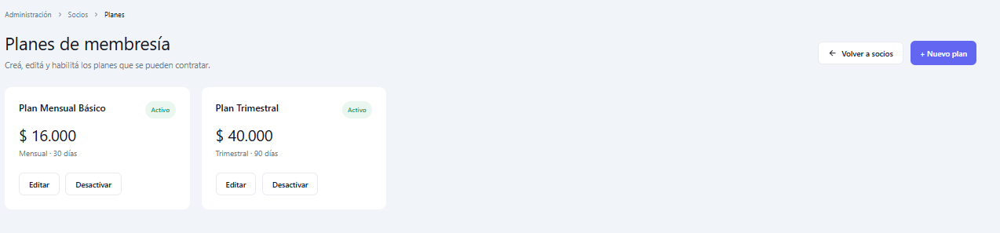

*(El resto del personal ve únicamente los planes activos, sin botones de edición).*

### 5.3 Lectura de los reportes consolidados

> **Fuera del alcance de esta versión.** No hay un módulo de reportes consolidados. La información disponible por sede es el aforo y los movimientos del Panel de Recepción, y los indicadores de membresías de la pantalla Socios.

## 6. Preguntas frecuentes

* **¿Puedo registrarme yo mismo?**
  No. El alta la hace el personal en recepción.

* **¿Por qué me desconecta cada tanto?**
  La sesión dura 30 minutos por seguridad. Volvé a ingresar.

* **Soy cliente externo y no veo "Clases" ni "Socios".**
  Es lo esperado: el cliente externo solo accede a **Canchas**.

* **¿Puedo capturar mi QR y mandarlo por mensaje?**
  No sirve: el código vence en aproximadamente un minuto.

* **Entré a una sede, ¿puedo ir a otra?**
  Sí, pero primero tenés que registrar tu salida en la primera. No podés figurar en dos sedes a la vez.

* **Me rechazaron el pago, ¿se cobró?**
  No. Un pago rechazado no renueva la membresía ni confirma la reserva. El historial muestra el intento como *Rechazado*.

* **¿Guardan los datos de mi tarjeta?**
  No. El sistema no recibe ni guarda números de tarjeta ni CVV; trabaja con tokens de la pasarela.

* **¿Dónde veo los avisos de lugar liberado en una clase?**
  En **Clases → Notificaciones** (solo socios).

* **Me anoté en lista de espera pero no me avisaron.**
  Entrá a **Clases**: la agenda se actualiza cada 30 segundos y la oferta aparece en **Notificaciones** y en tu tarjeta de la clase.

* **¿Por qué no puedo reservar una clase de la semana que viene?**
  Las reservas se abren 48 horas antes del inicio. Sí podés anotarte en la lista de espera si está completa.

## 7. Limitaciones conocidas de esta versión

Para que el manual sea fiel al sistema entregado, estas son las diferencias entre lo previsto y lo implementado:

1. **Sin registro autónomo:** todos los usuarios los crea el personal (**Socios → + Nuevo socio**, o **Acceso → + Ingreso Externo**).

2. **Sin penalidades:** solo hay plazos de cancelación (2 horas y 48 horas).

3. **Cancelación de canchas:** el portal no ofrece cancelar una reserva de cancha ya confirmada.

4. **Pago de canchas:** solo funciona la opción *Tarjeta / Online*. La opción *Pagar en Sede* está visible pero el servidor la rechaza como medio no soportado.

5. **Precio de cancha y tarifa de socio:** el cobro toma el precio de socio que muestra la grilla. La tarifa de externo para el socio en mora (`RN-03`) existe en el servidor como estrategia, pero el cobro de la reserva todavía no la aplica según el perfil de quien paga.

6. **Fuera de alcance:** inhabilitar canchas por mantenimiento, alta de sedes, edición de precios y horario pico, reportes consolidados.

7. **Pantalla de pagos (`PagosScreen`):** existe en el código como herramienta de prueba, pero no está enlazada en la navegación.